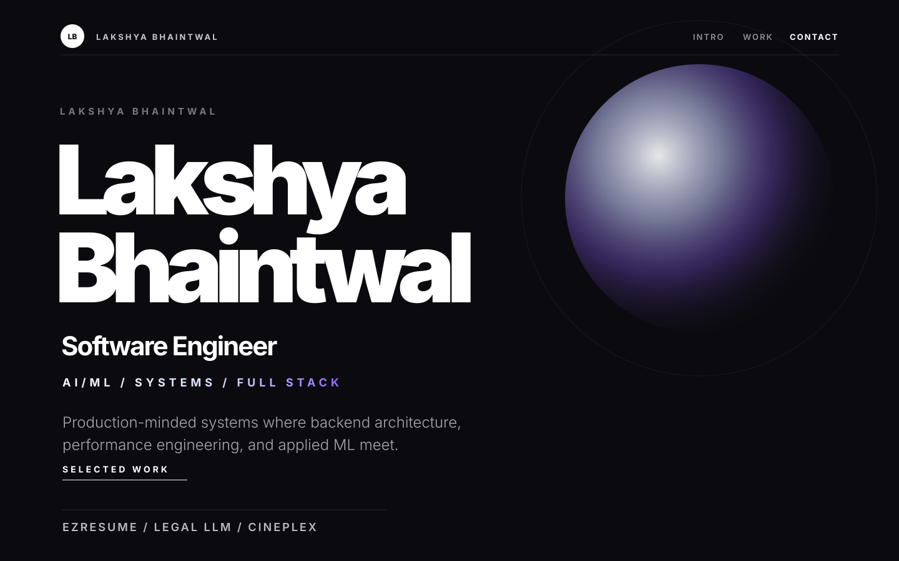

# Lakshya Bhaintwal Portfolio

Minimal, typography-driven portfolio showcasing software engineering, AI/ML systems, selected work, and professional background.

## Live Demo

[portfolio-qujys8gbt-idealsteve001-6099s-projects.vercel.app](https://portfolio-qujys8gbt-idealsteve001-6099s-projects.vercel.app)

## Preview



## Tech Stack

- Next.js
- TypeScript
- Tailwind CSS
- Framer Motion

## Features / Highlights

- Editorial, typography-first interface
- Custom cursor and subtle motion interactions
- Scroll reveal animations with Framer Motion
- Curated Selected Work section with project impact and links
- Responsive dark-first design
- SEO-ready metadata and production build support
- Vercel-ready configuration

## Setup Instructions

```bash
npm ci
npm run dev
```

Open locally:

```text
http://127.0.0.1:3000
```

Run quality checks:

```bash
npm run lint
npm run build
```

## Deployment

This project is configured for Vercel.

- Framework: Next.js
- Install command: `npm ci`
- Build command: `npm run build`
- Output directory: `.next`

Deploy by connecting the GitHub repository to Vercel. Every push to `main` can trigger an automatic production deployment.

## Contact

- GitHub: [github.com/lakshyabhaintwal](https://github.com/lakshyabhaintwal)
- LinkedIn: [linkedin.com/in/lakshya-bhaintwal](https://linkedin.com/in/lakshya-bhaintwal)
